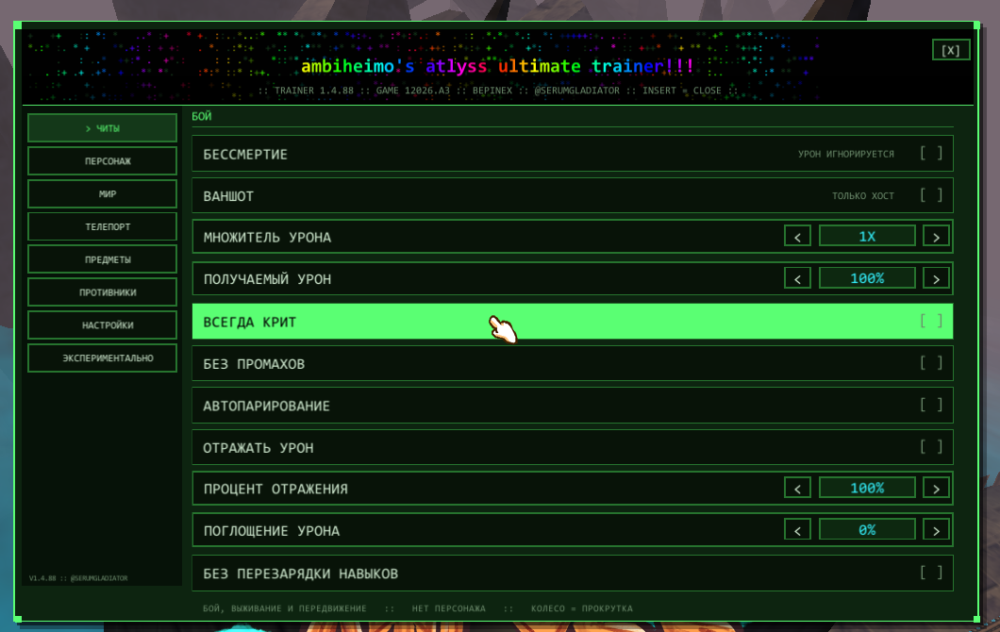

# Atlyss Trainer

[Русская версия](README.ru.md)

A BepInEx 5 trainer for **ATLYSS** with an in-game menu.



The menu reads item and enemy names directly from the running game, so it works correctly with any installed translation mod.

## Features

### Combat
- God mode.
- One-hit kill and outgoing damage multiplier (1–100x).
- Incoming damage multiplier (0–200%) and flat damage absorption.
- Always critical hits, perfect accuracy, auto parry, damage reflection.
- No skill cooldowns, instant cast, automatic debuff purge.
- Infinite mana and stamina, health lock.
- Restore all, kill nearby enemies, kill every enemy on the map.

### Movement
- Movement speed 100–1000%.
- Jump height 100–1000%.
- Up to 20 jumps in a row.
- No dash cooldown.
- Gravity 0–500%.
- Noclip / fly (WASD + Space, host only).

### Character
- Class change and class tier.
- Level, experience, gold, attribute and skill points.
- Every value from the game's stat struct (HP, mana, stamina, attack, magic, dexterity, defenses, crit, evasion, resistances).
- Professions: levels for every profession.
- Appearance: height, width, torso, arms, head, belly, bottom, chest; hide armor slots.

### World
- Time of day: hour, dawn/noon/dusk/night, freeze the cycle.
- Weather on the local map instance.
- Enable or disable enemy spawners.

### Teleport
- Every spawn point of the current map, with distance and attuned waypoints marked.
- World map travel via the game's scene transport.

### Items
- Full item catalog with icons, rarity colors, search, type filter and quantity.
- Sorting: name, price (asc/desc), level (asc/desc), rarity.
- Details panel: slot, requirements, stat bonuses, description, price.
- Add to inventory, equip, duplicate, drop (host).

### Enemies
- Full enemy catalog with search, level and stat modifier.
- Spawn next to the player (host), freeze AI, kill all.

### Interface
- Menu scale, background transparency (0–90%), six colour themes (green, amber, cyan, magenta, black, red).
- Font selection (8 system fonts) and banner FPS (1–30) with an animation toggle.
- Active cheats overlay with its own hotkey.
- Rebindable hotkeys and three cheat presets.
- Input lock: while the menu is open the character cannot move, the camera does not rotate and LMB does not attack.
- Russian and English interface, driven by the installed translation dictionary.

### Experimental
A separate tab with risky actions, locked behind a warning and a confirmation checkbox. Includes a one-click profile backup.
- Give every item.
- Complete active quests.
- Unlock every skill.
- Unlock every waypoint.
- Force profile save.
- Character scale.

## Installation

1. Install **BepInEx 5 (x64, Mono)** into the ATLYSS folder.
2. Copy `AtlyssTrainer.dll` into `ATLYSS\BepInEx\plugins\`.
3. Launch the game and press **Insert**.

## Hotkeys

| Key | Action |
| --- | --- |
| `Insert` | Open / close the menu |
| `Esc` | Close the menu or cancel inline input |
| `F3` | Toggle the active cheats overlay |

The menu key, overlay key and a god-mode hotkey can be rebound in the settings.

## Building

The project uses the .NET Framework compiler that ships with Windows, so no .NET SDK is required.

```powershell
.\build.ps1            # build into .\dist
.\build.ps1 -Install   # build and copy into BepInEx\plugins
```

Adjust the `$game` variable in `build.ps1` if the game is installed elsewhere.

## Configuration

Settings are stored in `BepInEx\config\peppa.atlyss.cheatmenu.cfg`.
Profile backups created from the experimental tab go to `BepInEx\cheatmenu_backups\`.

## Limitations

- ATLYSS is server-authoritative (Mirror). Cheats that change the world or other players work only for the host. Clients can change their own health display, stats, gold, inventory, local time/lighting and weather.
- Stats are written directly into the stat structs. Equipping gear or changing level recalculates them and manual values are reset — this is expected.
- Item and enemy names are read from live `ScriptableObject` caches and translated with the installed translation dictionary (`Translation\phrases.json` and `regex_phrases.json`). Without the translation mod the menu falls back to English.
- The mod does not modify game files. The experimental tab writes into the character profile, which is why it is gated and backed up.

## Project structure

```
src/Plugin.cs                    entry point, config, hotkeys
src/Core/L10n.cs                 translation dictionary and game text lookup
src/Core/GameApi.cs              game data access and actions
src/Core/Overlay.cs              active cheats overlay
src/Core/Presets.cs              three cheat presets
src/Core/Backup.cs               profile backup
src/Patches/Patches.cs           Harmony patches (damage, time, cooldowns, input lock)
src/UI/Ui.cs                     sprites, fonts, theme, UI primitives
src/UI/Widgets.cs                toggles, value rows, key binds, virtual lists
src/UI/Menu.cs                   window, tabs, banner, input
src/UI/Tabs/StatsTabs.cs         cheats, character, world, teleport
src/UI/Tabs/SpawnTabs.cs         items, enemies, settings
src/UI/Tabs/ExperimentalTab.cs   risky actions
tools/ApiDump/Dump.cs            Mono.Cecil API dumper used during development
```

## Notes

- Use on your own saves and your own hosted lobbies.
- Back up `ATLYSS_Data\profileCollections` before using the experimental tab.
- Built and tested against ATLYSS `12026.a3`, BepInEx 5.4.23.5, Unity 2022.3.

## Credits

- [BepInEx](https://github.com/BepInEx/BepInEx) and HarmonyX.
- The ATLYSS modding community for the public API discoveries and translation dictionaries.
