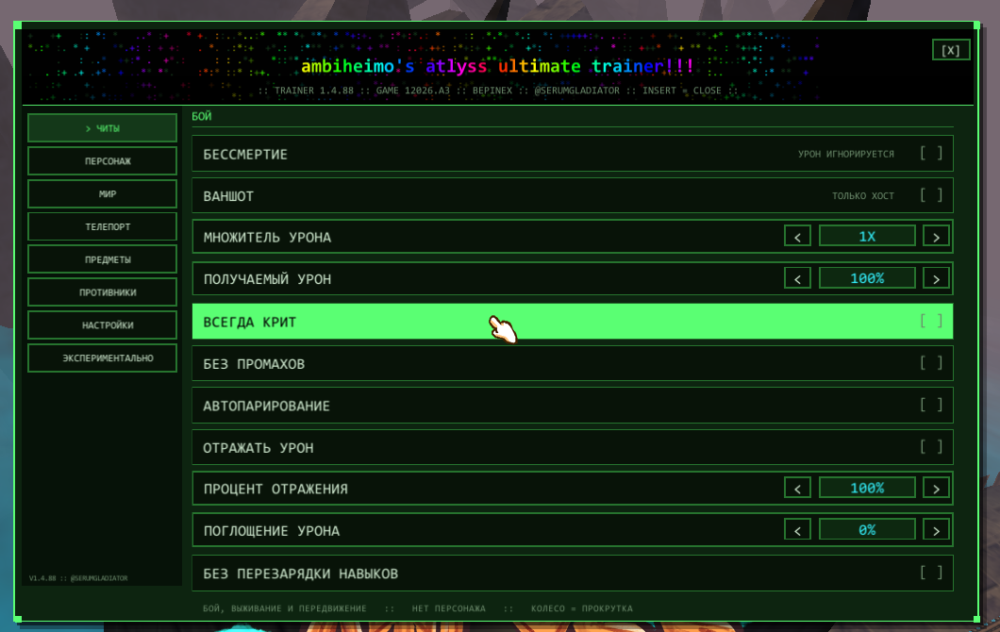

# Atlyss Trainer

[English version](README.md)

Трейнер для **ATLYSS** на BepInEx 5 с меню прямо в игре.



Названия предметов и врагов читаются из запущенной игры, поэтому мод корректно работает с установленным русификатором.

## Возможности

### Бой
- Бессмертие.
- Ваншот и множитель исходящего урона (1–100x).
- Множитель получаемого урона (0–200%) и поглощение урона.
- Всегда крит, без промахов, автопарирование, отражение урона.
- Без перезарядки навыков, мгновенный каст, автоснятие дебаффов.
- Бесконечная мана и выносливость, блокировка здоровья.
- Восстановить всё, убить врагов рядом, убить всех на карте.

### Передвижение
- Скорость движения 100–1000%.
- Высота прыжка 100–1000%.
- До 20 прыжков подряд.
- Без перезарядки рывка.
- Гравитация 0–500%.
- Noclip / полёт (WASD + пробел, только хост).

### Персонаж
- Смена класса и ранга класса.
- Уровень, опыт, золото, очки атрибутов и навыков.
- Все значения из статов игры (HP, мана, выносливость, атака, магия, ловкость, защиты, крит, уклонение, сопротивления).
- Профессии: уровни всех профессий.
- Внешность: рост, ширина, торс, руки, голова, живот, низ, грудь; скрытие слотов брони.

### Мир
- Время суток: час, рассвет/полдень/закат/ночь, остановка цикла.
- Погода на локальном инстансе карты.
- Включение и отключение спавнеров врагов.

### Телепорт
- Все точки спавна текущей карты с дистанцией и отметкой освоенных вейпоинтов.
- Переход между картами мира через игровой scene transport.

### Предметы
- Полный каталог с иконками, цветами редкости, поиском, фильтром по типу и количеством.
- Сортировка: имя, цена (по возрастанию/убыванию), уровень (по возрастанию/убыванию), редкость.
- Панель деталей: слот, требования, бонусы характеристик, описание, цена.
- Добавить в инвентарь, надеть, дублировать, выбросить (хост).

### Противники
- Полный каталог с поиском, уровнем и модификатором статов.
- Спавн рядом с игроком (хост), заморозка ИИ, убить всех.

### Интерфейс
- Масштаб меню, прозрачность фона (0–90%), шесть цветовых тем (зелёная, янтарь, циан, пурпур, чёрная, красная).
- Выбор шрифта (8 системных), FPS баннера (1–30) и тумблер анимации.
- Оверлей активных читов со своей клавишей.
- Переназначение клавиш и три пресета читов.
- Блокировка ввода: пока меню открыто, персонаж не двигается, камера не вращается, ЛКМ не атакует.
- Русский и английский интерфейс через словарь установленного русификатора.

### Экспериментально
Отдельная вкладка с рискованными действиями, закрытая предупреждением и галочкой подтверждения. Есть бэкап профиля в один клик.
- Выдать все предметы.
- Завершить активные квесты.
- Открыть все навыки.
- Открыть все вейпоинты.
- Принудительно сохранить профиль.
- Масштаб персонажа.

## Установка

1. Установите **BepInEx 5 (x64, Mono)** в папку ATLYSS.
2. Скопируйте `AtlyssTrainer.dll` в `ATLYSS\BepInEx\plugins\`.
3. Запустите игру и нажмите **Insert**.

## Клавиши

| Клавиша | Действие |
| --- | --- |
| `Insert` | Открыть / закрыть меню |
| `Esc` | Закрыть меню или отменить ввод |
| `F3` | Показать / скрыть оверлей активных читов |

Клавишу меню, оверлея и бессмертия можно переназначить в настройках.

## Сборка

Используется компилятор .NET Framework из Windows, .NET SDK не нужен.

```powershell
.\build.ps1            # собрать в .\dist
.\build.ps1 -Install   # собрать и скопировать в BepInEx\plugins
```

Если игра установлена в другом месте, измените переменную `$game` в `build.ps1`.

## Конфигурация

Настройки: `BepInEx\config\peppa.atlyss.cheatmenu.cfg`.
Бэкапы профиля из экспериментальной вкладки: `BepInEx\cheatmenu_backups\`.

## Ограничения

- ATLYSS сервер-авторитетный (Mirror). Читы, меняющие мир или других игроков, работают только у хоста. Клиент может менять свой HUD, статы, золото, инвентарь, локальное время/освещение и погоду.
- Статы записываются напрямую в структуры. Смена экипировки или уровня пересчитывает их, ручные значения сбрасываются — это ожидаемо.
- Названия предметов и врагов читаются из живых кэшей `ScriptableObject` и переводятся словарём русификатора (`Translation\phrases.json` и `regex_phrases.json`). Без русификатора меню работает на английском.
- Мод не изменяет файлы игры. Экспериментальная вкладка пишет в профиль персонажа, поэтому она закрыта подтверждением и бэкапом.

## Структура

```
src/Plugin.cs                    точка входа, конфиг, горячие клавиши
src/Core/L10n.cs                 словарь перевода и поиск игровых строк
src/Core/GameApi.cs              доступ к игровым данным и действиям
src/Core/Overlay.cs              оверлей активных читов
src/Core/Presets.cs              три пресета читов
src/Core/Backup.cs               бэкап профиля
src/Patches/Patches.cs           Harmony-патчи (урон, время, кулдауны, блокировка ввода)
src/UI/Ui.cs                     спрайты, шрифты, тема, примитивы
src/UI/Widgets.cs                тумблеры, значения, клавиши, списки
src/UI/Menu.cs                   окно, вкладки, баннер, ввод
src/UI/Tabs/StatsTabs.cs         читы, персонаж, мир, телепорт
src/UI/Tabs/SpawnTabs.cs         предметы, противники, настройки
src/UI/Tabs/ExperimentalTab.cs   рискованные действия
tools/ApiDump/Dump.cs            дампер API на Mono.Cecil для разработки
```

## Примечания

- Используйте на своих сохранениях и в своих лобби.
- Перед экспериментальной вкладкой сделайте бэкап `ATLYSS_Data\profileCollections`.
- Собрано и проверено на ATLYSS `12026.a3`, BepInEx 5.4.23.5, Unity 2022.3.

## Благодарности

- [BepInEx](https://github.com/BepInEx/BepInEx) и HarmonyX.
- Сообществу моддеров ATLYSS за исследования API и словари перевода.
